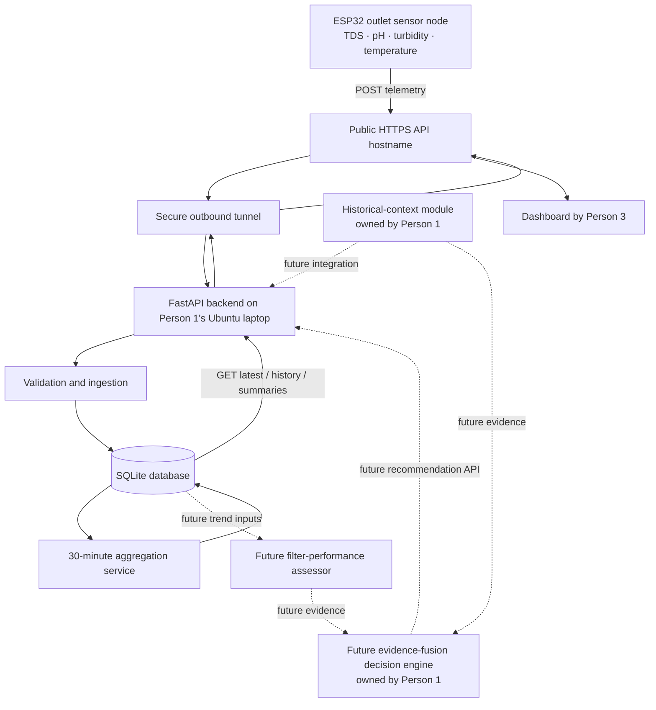

# AquaSentinel Backend Architecture — V1

## 1. Purpose

This document defines the backend that receives outlet sensor telemetry from the ESP32, validates and stores it, creates completed 30-minute summaries, and serves dashboard data to the AquaSentinel frontend.

**Hosting decision:** the backend runs on Person 1's Ubuntu laptop. A secure outbound tunnel (planned: Cloudflare Tunnel) exposes a public HTTPS hostname that forwards to the laptop's local FastAPI service. The ESP32 and dashboard therefore do not need to share the same Wi-Fi network.

The tunnel provides network access; it does not move the Python application, datasets, or database into a cloud server. The laptop, FastAPI process, internet connection, and tunnel must remain available.

## 2. System context



## 3. V1 backend scope

### Included in this backend milestone

1. FastAPI application and versioned `/api/v1` routes.
2. Authenticated ESP32 telemetry ingestion.
3. Payload/schema/unit/timestamp validation.
4. Duplicate and out-of-order sample handling.
5. Raw sensor-reading persistence in SQLite.
6. Latest-reading and history query endpoints.
7. Completed 30-minute sensor summaries.
8. Device connectivity/freshness status.
9. Health endpoint and API documentation.
10. Secure remote access through a tunnel to the laptop-hosted API.

### Explicitly out of scope for this milestone

- Building or changing the existing CGWB/CPCB historical-context module.
- Implementing the historical-context analysis itself. Person 1 owns that module and will provide its callable interface/response contract for later integration.
- Implementing the RO decision engine.
- Implementing or claiming a validated filter-health score.
- Sending commands to an Atomberg purifier or changing pump pressure, flow, valves, or operating modes.
- Moving the backend/database to a cloud VM.

The backend should keep clean extension points for historical-context and future decision-engine services, but must not return fabricated results for them.

## 4. Data path

### ESP32 to backend

1. ESP32 acquires all available outlet sensors at a configurable interval (initial target: 10 seconds).
2. ESP32 packages one sample with `device_id`, monotonically increasing `sequence`, capture timestamp, measurement point and per-sensor values/status/calibration state.
3. ESP32 sends `POST /api/v1/sensors/outlet` to the public HTTPS API hostname.
4. The tunnel forwards the request to FastAPI on the laptop.
5. Backend authenticates the device and validates the payload.
6. Backend records its own `received_at` timestamp, deduplicates the sample, stores the accepted raw sample and returns an acknowledgement.
7. If the network fails, ESP32 should retry with backoff and, where feasible, buffer a bounded number of unsent samples. Re-sent samples must be deduplicated by device and sequence.

### Backend to dashboard

1. Dashboard requests latest outlet readings, history, summaries and device status using GET endpoints.
2. Backend queries SQLite and returns JSON.
3. Dashboard displays backend-provided values and summaries. It must not calculate the 30-minute statistics itself.
4. Frontend may poll latest readings every 5–10 seconds initially. Summary endpoint can be polled less frequently or after a window is expected to close.

## 5. Runtime components

Recommended initial modules:

```text
backend/
  main.py                    # FastAPI application and lifespan
  api/routes/
    health.py
    sensors.py               # POST ingestion
    outlet.py                # latest/history/summary
    devices.py               # device status
  schemas/
    telemetry.py             # Pydantic request/response models
    outlet.py
  services/
    ingestion.py             # validate, deduplicate, persist
    aggregation.py           # close and summarize 30-minute windows
    device_status.py
  database/
    connection.py
    models.py
    migrations/              # or a documented schema-init mechanism
  config.py                  # environment-based settings
  tests/
  requirements.txt
```

The exact package layout may differ, but route handlers should remain thin. Business logic belongs in services; database access belongs in a data layer.

## 6. Time and aggregation rules

- ESP32 `timestamp` is the measurement/capture time and must be ISO 8601 with an explicit UTC offset or `Z`.
- Backend records `received_at` independently using the server clock.
- Normalize timestamps to UTC for storage and fixed-window grouping. Return ISO 8601 timestamps; frontend may render them in local time.
- Use fixed half-hour windows: `[00:00, 00:30)`, `[00:30, 01:00)`, and so on in UTC. Document this convention in API responses.
- With a 10-second target interval, the nominal expected count is 180 samples per sensor per 30-minute window. This is a target, not a guarantee.
- Do not mark a summary complete until the window has closed. Do not silently fill missing readings.
- Return expected, received, valid, invalid, uncalibrated and missing counts where available, plus coverage.
- Compute mean, median, min, max and standard deviation only from values eligible for the relevant statistic. The implementation must document whether calibrated-only values are required; for water-quality assessment, exclude uncalibrated values from assessment statistics and report their count separately.
- Configure the minimum data coverage required for a summary to be considered usable. Do not invent a water-safety threshold; this is a data-quality setting.
- Retain raw records after summarization.
- Aggregation must be idempotent. A restart must not create duplicate summaries; the backend should be able to backfill any closed, unprocessed windows from raw records.

## 7. Backend responsibilities vs. future modules

The V1 backend is responsible for transport, validation, storage, aggregation and serving data. It should not mix all project intelligence into route handlers.

Future integration boundaries:

- Historical context: Person 1 supplies an adapter that accepts source type and location ID and returns the existing module's genuine structured result.
- Filter performance: a separate assessor may analyze multi-window outlet trends and maintenance records. In V1, the UI labels this R&D in progress; do not expose a fake health status.
- Decision engine: a separate fusion service owned by Person 1 may later consume historical and outlet assessments. No operating-mode recommendation is part of this backend milestone.

## 8. Definition of done

- FastAPI starts on the laptop and exposes `/api/v1/health`.
- Authenticated ESP32-format sample is accepted and stored.
- Invalid payloads are rejected with useful error responses.
- Duplicate device/sequence submissions are not stored twice.
- Latest and history endpoints return actual stored records.
- A closed 30-minute window produces an idempotent summary with data-coverage metadata.
- Restarting the backend does not lose stored records or permanently skip a closed window.
- Dashboard can consume the GET endpoints using mock or real API responses.
- Tunnel-based remote request works without requiring ESP32 and laptop to share Wi-Fi.
- Secrets are not committed to GitHub.
