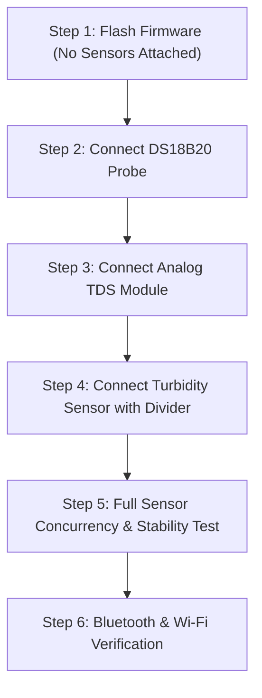
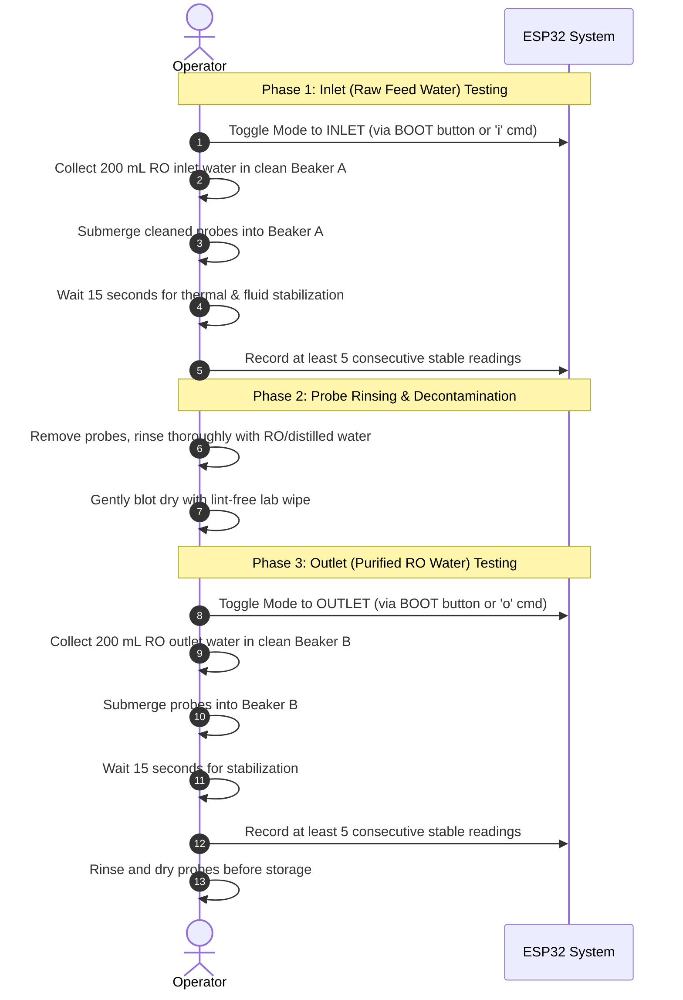

# AquaSentinel Hardware Testing & Validation Protocol

This document defines the step-by-step testing procedure for **Milestone 1 (Hardware Bring-up & Sensor Acquisition)** and the operational protocol for sequential **RO Inlet/Outlet testing** using the **ESP32-WROOM-32E (Wi-Fi + BT)**.

---

## 1. Milestone 1 Bring-Up Checklist

Follow this orderly procedure to commission the system safely without risking damage to the ESP32.

---

### Step 1: Flash Firmware (Standalone Board Test)
1. Open `firmware/aquasentinel.ino` in Arduino IDE or open the project folder in PlatformIO.
2. In Arduino IDE:
   - Select Board: **ESP32 Dev Module** (or **ESP32-WROOM-32E**).
   - Select CPU Frequency: **240 MHz**.
   - Select Flash Size: **4MB**.
   - Select Upload Speed: **921600** or **115200**.
   - Select your USB-to-UART COM port.
3. In `firmware/config.h`:
   - Enter your local Wi-Fi SSID and Password (or set `ENABLE_WIFI 0` for standalone bench testing).
   - Ensure `ENABLE_BLUETOOTH 1` is set.
4. Compile and flash the code.
5. Open the Serial Monitor at **115200 baud**.
6. **Expected Output:**
   - AquaSentinel banner with firmware version and Device ID.
   - ADC resolution configured message.
   - Bluetooth initialization message (`Bluetooth Serial started as "AquaSentinel-ESP32E"`).
   - Sensor readings appearing every 2.0 seconds with `[INVALID]` for the unconnected DS18B20.

---

### Step 2: DS18B20 Temperature Probe Bring-Up
1. Disconnect USB power from the ESP32.
2. Wire DS18B20 $V_{DD}$ to 3.3V, GND to GND, and DATA to GPIO4.
3. Install the **4.7 kΩ pull-up resistor** between GPIO4 and 3.3V.
4. Power up the board and inspect the Serial Monitor.
5. **Validation Checks:**
   - [ ] Ambient reading shows plausible room temperature (e.g., $22^\circ\text{C}$ to $32^\circ\text{C}$) marked as `[VALID]`.
   - [ ] Hold the stainless steel probe in your hand; the temperature must rise within 5–10 seconds.
   - [ ] **Fault injection test:** Disconnect the yellow/white DATA wire. The Serial Monitor must immediately transition from `[VALID]` to `ERROR / SENSOR DISCONNECTED [INVALID]` (temperature reading $-127.0^\circ\text{C}$). Reconnecting the wire must automatically restore valid readings without restarting the ESP32.

---

### Step 3: Analog TDS Sensor Bring-Up
1. Disconnect USB power.
2. Wire the TDS module VCC to 3.3V, GND to GND, and AOUT to GPIO34.
3. Power up the board.
4. **Air Baseline Test:**
   - Leave the probe dry in open air.
   - Raw ADC count should read near zero ($0$ to $50$ counts, $0.00\text{ V}$ to $0.05\text{ V}$).
5. **Tap Water Test:**
   - Submerge probe prongs in a glass of tap water.
   - Voltage must rise to between $0.4\text{ V}$ and $1.5\text{ V}$ (raw ADC $\sim 500$ to $2000$).
6. **Saline Response Test:**
   - Dissolve a pinch of table salt into the water.
   - Raw ADC and voltage must noticeably increase, reflecting higher ionic conductivity.
   - Confirm raw ADC does **not** saturate at 4095.

---

### Step 4: Turbidity Sensor Bring-Up
1. Disconnect USB power.
2. Wire Turbidity module VCC to 5V (VIN), GND to GND.
3. Insert the **voltage divider** ($R_1 = 10\text{ k}\Omega$, $R_2 = 20\text{ k}\Omega$) between Turbidity AOUT and ESP32 GPIO35.
4. Before connecting to GPIO35, verify with a multimeter that the voltage at the junction is $\le 3.1\text{ V}$.
5. Connect junction to GPIO35 and power the board.
6. **Clear Water Test:**
   - Place sensor probe in clean, clear tap water.
   - Sensor should register its highest optical transmission voltage ($\sim 2.5\text{ V} - 3.0\text{ V}$ at the ADC input).
7. **Turbid Water Test:**
   - Add a drop of milk or a pinch of flour to the water and stir.
   - Turbidity analog voltage should drop significantly as light transmission is scattered.
   - Confirm readings are responsive and stable.

---

### Step 5: Full Sensor Concurrency Test
1. Run all three sensors simultaneously in a single water container.
2. Ensure readings update every 2 seconds without stalls.
3. Verify that the Wi-Fi transmission or Bluetooth activity does not corrupt the ADC readings. (Because GPIO34 and GPIO35 are on ADC1, readings remain clean and stable while Wi-Fi/BT is active).

---

### Step 6: Bluetooth Telemetry & Control Verification
1. On your smartphone or laptop, open a Bluetooth terminal app (e.g., *Serial Bluetooth Terminal* for Android, or terminal emulator on PC).
2. Scan and pair with device: **`AquaSentinel-ESP32E`**.
3. Confirm that formatted telemetry records are streaming over the Bluetooth terminal.
4. Send the character **`o`** or **`O`** from the terminal:
   - Confirm terminal and Serial Monitor respond: `[MODE] Sample set to: OUTLET`.
5. Send the character **`i`** or **`I`**:
   - Confirm mode reverts to: `[MODE] Sample set to: INLET`.
6. Press the physical **BOOT button (GPIO0)** on the ESP32 board:
   - Confirm sample mode toggles cleanly with LED double-blink feedback.

---

## 2. Sequential RO Inlet / Outlet Sampling Protocol

Because the prototype uses a single set of sensors, testing an RO purifier requires a disciplined sequential protocol to avoid cross-contamination.

### Data Collection Log Sheet Template

| Session ID | Sample Type | Sample # | Time | TDS ADC Raw | TDS Voltage (V) | Turbidity ADC | Turbidity V | Temp (°C) | Notes |
| :--- | :--- | :--- | :--- | :--- | :--- | :--- | :--- | :--- | :--- |
| `SESSION-001`| `INLET` | 1 | 14:00 | | | | | | Tap inlet |
| `SESSION-001`| `INLET` | 2 | 14:02 | | | | | | Tap inlet |
| `SESSION-001`| `INLET` | 3 | 14:04 | | | | | | Tap inlet |
| `SESSION-001`| `OUTLET`| 1 | 14:10 | | | | | | RO outlet |
| `SESSION-001`| `OUTLET`| 2 | 14:12 | | | | | | RO outlet |
| `SESSION-001`| `OUTLET`| 3 | 14:14 | | | | | | RO outlet |

---

## 3. Hardware Troubleshooting & Fault Isolation

| Symptom / Observation | Root Cause | Corrective Action |
| :--- | :--- | :--- |
| **DS18B20 reads `-127.0°C`** | Probe disconnected, wire broken, or missing pull-up resistor. | Check wiring continuity; verify 4.7 kΩ resistor is present between GPIO4 and 3.3V. |
| **DS18B20 reads `85.0°C`** | Read performed before temperature conversion completed. | The firmware's non-blocking timing ensures $\ge 750\text{ ms}$ between request and read. Ensure conversion is not interrupted. |
| **Turbidity ADC reads `4095`** | Over-voltage at ADC pin ($> 3.3\text{ V}$) causing saturation. | **Disconnect immediately.** Verify voltage divider ($10\text{ k}\Omega / 20\text{ k}\Omega$). Check that ground is shared. |
| **TDS voltage is flat / zero** | Probe unplugged or probe disconnected from driver board. | Verify probe connection to the 2-pin driver header; clean electrode pins with rubbing alcohol. |
| **ADC readings fluctuate wildly** | Floating ground, 50Hz AC noise, or power supply ripple. | Ensure all module grounds are tied directly to ESP32 GND. Use a stable USB power source, not noisy laptop charger hubs. |
| **Wi-Fi will not connect** | 5 GHz band mismatch or weak RSSI. | ESP32-WROOM-32E supports **2.4 GHz only**. Ensure router 2.4 GHz SSID is selected in `config.h`. |
| **Bluetooth not appearing in scan** | Bluetooth stack disabled or RAM constraint. | Confirm `ENABLE_BLUETOOTH 1` in `config.h`. Ensure board setting in IDE has Bluetooth enabled. |

